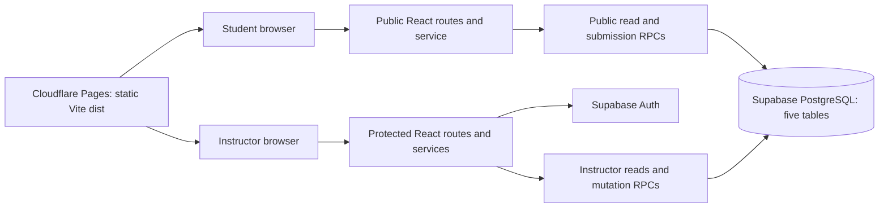

# Classroom Survey — Implementation Plan

Review date: 2026-11-02 (America/New_York).

Status: requirements review and planning only. Application implementation, database provisioning, application tests, and deployment have not been performed in this phase.

## 1. Authority and scope

Read in full: [ASSIGNMENT.md](../ASSIGNMENT.md), [SPEC.md](../SPEC.md), [DATABASE.md](../DATABASE.md), [API.md](../API.md), [UI.md](../UI.md), and [TODO.md](../TODO.md). The assignment is authoritative; the user's current instructions fix the stack and add detail to its requirements. Resolve underspecified behavior through [DECISIONS.md](DECISIONS.md), without editing the supplied specifications.

The assignment's `Classroom_Survey_Web_App_Specification.md` is represented here by the supplied `SPEC.md`; do not create a competing specification. Preserve all five domain tables and the specified technology stack.

### Observed starting state

- `src/`, `public/`, and `supabase/migrations/` are empty. `docs/evidence/` exists and is empty.
- `package.json` retains starter React/React DOM dependencies and Vite/TypeScript scripts. Tailwind, React Router, the Supabase client, Recharts, and `qrcode` are absent from its dependencies. No lockfile or installed dependencies are present.
- `index.html`, application entry points, Vite/TypeScript configurations, and lint configuration are absent. The lint script refers to Oxlint; the supplied TODO asks for ESLint and formatting.
- `.env.example` is empty. `.gitignore` excludes `*.local`, dependencies, build output, and `.DS_Store`, but does not exclude a plain `.env` or every environment variant.
- `README.md` is starter documentation referencing configuration that is absent.
- Node v24.14.1, npm 11.11.0, Git 2.52.0, and GitHub CLI 2.87.0 are available locally. Package compatibility and registry availability have not been checked by installation.
- `git rev-parse --show-toplevel` fails: this directory is not currently a Git repository. No GitHub remote, Supabase project state, or Cloudflare deployment was inspected.
- At the initial review, `TODO.md` contained 123 checked and 41 unchecked entries that were not verified project status. The byte-for-byte [original snapshot](TODO_ORIGINAL.md) preserves that input; the current root TODO was later updated only with evidence-backed progress.

No application build was attempted: the entry points, configurations, and dependencies required for one are absent. No external setup can be inferred from local SQL examples or checklist marks.

## 2. Requirements inventory and acceptance evidence

All rows below are requirements to implement or verify, not completed work. Phase references refer to this plan.

| Area / source | Required behavior | Planned evidence / phase |
| --- | --- | --- |
| Stack — user, SPEC §7, TODO 1 | React + TypeScript + Vite, Tailwind CSS, React Router, Supabase JS/Auth/PostgreSQL, Recharts, `qrcode`, Git/GitHub, Cloudflare Pages; ESLint and formatting | Dependency manifest, lockfile, successful clean install/typecheck/lint/build; phase 1 |
| Instructor identity — assignment §4.1, API §1, UI §§1–3, TODO 3 | Email/password login, logout, session restoration, auth-change subscription, protected routes, instructor identity on dashboard | Signed-out redirect, refresh, expiration, logout, and non-instructor denial tests; phases 2–3 |
| Dashboard — SPEC §§3–4, UI §4, TODO 4/10 | Survey title, status, creation date, New/Edit/Duplicate/Delete/Archive/Results/Activate/Close actions; title search, status and historical date filters | Database-backed list and filtering tests, action availability and empty states; phases 3/6 |
| Editor — assignment §4.1, SPEC §4, UI §5, TODO 5 | Title, optional description, one or more questions; multiple choice and true/false; add/remove/reorder questions and choices; save/load drafts; field validation | Editor tests, atomic saved graph, refresh persistence, blocked active/historical mutation; phase 3 |
| Lifecycle — assignment §4.1, DATABASE §§2/5/6/13, API §§6–8, TODO 6/12 | Draft/active/closed/archived; at most one active globally; activation closes previous; close prevents new submissions; duplication copies content only into a named draft; archive preserves history; confirmed deletion cascades | Database transactions, concurrent activation/close tests, distinct copied IDs, retained responses, cascade verification; phases 2–4 |
| Presentation — assignment §4.3, SPEC §4, UI §6, TODO 6 | Title, automatically derived public URL, large QR, readable fallback URL, downloadable PNG, submitted response count, Results and Close controls, projection-friendly layout | Decode generated PNG and scan with a physical phone; count/close checks; phase 4 |
| Public survey — assignment §4.2, API §§9–10, UI §§7–8, TODO 7 | `/s/:slug`, no login/account, correct ordered questions/choices, mobile layout, required answers, anonymous Supabase submission, friendly submitting/success/duplicate/closed/not-found states | Anonymous browser workflow, refresh, validation and closure race tests; phase 5 |
| Duplicate protection — assignment §4.2, DATABASE §§3/9/11, TODO 8 | Random locally stored browser token, token attached to response, database uniqueness per survey, friendly duplicate handling | Same-token sequential/concurrent retry tests and storage failure behavior; phases 2/5 |
| Persistence/security — assignment §5/9, DATABASE §§1–11, user | Exactly five domain tables; specified fields, FKs, indexes, status checks, timestamps, updated-at trigger, RLS; atomic activation/submission; no student submission/result reads or management; frontend publishable key only | Migration review and replay; denied direct API calls, denied instructor RPCs, cross-survey validation, transaction rollback, refreshed stored data; phase 2 and repeated release checks |
| Results — assignment §4.1, SPEC §4, API §11, UI §9, TODO 9/10 | Total and per-question counts, choice counts/percentages, Recharts bars plus numeric values, unanswered labels, zero states, Refresh; active and historical closed/archived results | Known fixtures, zero/legacy unanswered cases, historical integrity, instructor-only access; phase 6 |
| CSV — assignment §4.1, API §12, TODO 11 | All results, survey metadata, one row per response, timestamps, ordered question text and answers, safe escaping, instructor-only browser export | Parsed fixture comparison, quotes/newlines/Unicode/formulas, zero responses, spreadsheet checks; phase 6 |
| UX/accessibility — SPEC §§2/5, API §§13–14, UI §§5–15, TODO 13/14 | Responsive student/instructor screens; semantic controls/labels, keyboard use, visible focus, contrast, numeric charts, status text; loading/error/empty/saving feedback, disabled mutation buttons; destructive confirmations | Component and browser checks at phone/tablet/desktop widths, keyboard and contrast inspection, two browsers; throughout and phase 7 |
| Performance — SPEC §5 | At least 200 simultaneous students; average page load under two seconds; inexpensive/free hosting and database operation | Defined page-load measurement and 200-client exercise with request failures, latency, integrity and environment recorded; phase 7 |
| Delivery — assignment §§6–10, TODO 14/15 | GitHub source/specs/migrations/docs; public Cloudflare URL; production instructor/student workflow; safe grader access; setup/deployment README; TODO completion evidence | Commit/build/deployment identifiers, public route/phone smoke checks, reviewed repository and private grader instructions; phase 8 |
| Submission materials — assignment §7/8 | Approximately 1–2 page development summary, AI interaction history, database/question/response/application-result screenshots; exclude credentials and private student data | Reviewed deliverables in docs/evidence and documentation; phase 8 |

Out of scope for this release: TODO phase 16 and the specifications' future lists, including Realtime chart subscriptions, other question types, question bank, import/export JSON or Markdown, AI question generation, courses/semesters, multiple-instructor product features, student authentication, attendance, LMS integration, and cross-survey analytics. Polling a response count supports the required presentation experience without adding Realtime infrastructure.

## 3. Architecture



React renders and validates forms; Supabase JS provides Auth and data access; PostgreSQL enforces authorization, relationships, lifecycle invariants, and transactional writes. Cloudflare Pages serves static assets. No separate Express server, replacement database, paid infrastructure requirement, or browser service-role key is needed.

### Planned source organization

```text
src/
  main.tsx, App.tsx, index.css, vite-env.d.ts
  pages/           landing, login, dashboard, editor, present, results, student, not-found
  components/      layouts, forms, survey cards/editor, charts, QR, feedback, confirmations
  auth/            AuthProvider, RequireInstructor
  hooks/           request state and visibility-aware count polling
  lib/
    supabase.ts, env.ts, errors.ts, validation.ts, csv.ts, qr.ts, anonymousToken.ts
    services/      auth, surveys, publicSurvey, results
  types/           generated database types and application payloads
supabase/
  migrations/      ordered schema, authorization, RPC migrations
  tests/           database invariants and access checks
tests/             focused browser workflows and load exercise
public/            static assets and any documented Pages configuration
```

This tree is proposed; these application files are not created by this review. Keep network/database calls in typed services, form editing state local to the editor, and Auth session state in a provider. Avoid additional global-state/data-client frameworks unless a concrete need appears.

### Route responsibilities

| Route | Access | Page behavior |
| --- | --- | --- |
| `/` | Public | Minimal classroom survey introduction and instructor login link |
| `/login` | Public | Email/password login; redirect an authorized instructor to dashboard |
| `/dashboard` | Instructor | Search, status/date filters, survey actions, identity/logout, empty/error states |
| `/surveys/new` | Instructor | Create and save a draft |
| `/surveys/:id/edit` | Instructor | Load/edit eligible content; explain historical/active locks |
| `/surveys/:id/present` | Instructor | Title, QR/URL/PNG, count, results link and confirmed close |
| `/surveys/:id/results` | Instructor | Counts, bar charts/numeric alternatives, refresh, export, historical results |
| `/s/:slug` | Public | Load an active survey or minimal unavailable state, submit anonymously |
| `*` | Public shell | Friendly application not-found page |

All instructor pages wait for session initialization before redirecting. Deny authenticated users without instructor authorization; sanitize the return route to an internal path. UI route protection complements database authorization and never substitutes for it. Success/duplicate/closed are states of the public route; a separate success route is unnecessary.

### Components and services

| Group | Responsibilities |
| --- | --- |
| AuthProvider / RequireInstructor / InstructorLayout | Restore session with `getSession`, subscribe with `onAuthStateChange`, login with `signInWithPassword`, logout with `signOut`, check instructor claim, unsubscribe and clear protected state |
| SurveyCard / SurveyFilters / StatusBadge | Survey actions and status text, title/status/date filtering, created date, no-results state |
| SurveyEditor / QuestionEditor / ChoiceEditor | Stable client IDs while reordering, labeled fields, adjacent errors, up/down keyboard controls, pending navigation warning for unsaved work |
| ConfirmDialog / LoadingState / ErrorState / EmptyState | Consistent focus handling and asynchronous/destructive-action feedback |
| QRPanel / ResponseCount | Generate QR and PNG with `qrcode`; readable absolute URL; refresh count only while instructor presentation is visible |
| StudentSurveyForm / QuestionFieldset / SubmissionState | Single-column touch controls, all-required validation, token persistence, safe terminal/error states |
| ResultsChart / ResultsTable / CSVExportButton | Lazy-loaded Recharts, numeric counts/percentages, zero/unanswered states, safe downloadable CSV |
| `auth` service | Supabase Auth operations only; never creates instructors from the public frontend |
| `surveys` service | List/detail reads and transactional save/duplicate/activate/close/archive/delete operations |
| `publicSurvey` service | Minimal slug lookup and submission; public-key client with no persisted instructor session |
| `results` service | Instructor-only aggregates, count and paginated export reads |

Lazy-load instructor charts and QR modules so the public student route avoids their bundle cost. Cancel or ignore stale requests after navigation/logout; never keep results in a publicly shared cache. Persist no student answers in analytics/logs.

## 4. Database and operation contracts

Retain the five tables and columns in `DATABASE.md`: `surveys`, `questions`, `choices`, `responses`, `answers`. Supabase Auth's managed tables are platform infrastructure, not extra application tables. Preserve the specified cascading relationships, `choice_id` nullable historical compatibility, `text_answer` future compatibility, and timestamps. New v1 submissions select choices and do not supply text answers.

### Constraints and access

- Implement the supplied primary/foreign keys, unique public slug, status/type checks, unique response-question answer, recommended foreign-key/time indexes, updated-at trigger, and partial unique index for one active survey.
- Require nonblank titles/question text/choice text, positive sibling positions, and unique sibling positions. Use transaction-compatible/deferred uniqueness when swapping positions and normalize order to 1-based contiguous positions on save.
- Enforce a nonempty token in the submission RPC and the `(survey_id, anonymous_token)` unique index. The nullable schema column does not permit token-free public submissions.
- Validate cross-table answer ownership in the RPC and a database integrity trigger: response/question must share a survey, and choice must belong to the question. Ordinary foreign keys alone cannot prove these relationships.
- Enable RLS on all five tables and explicitly control table grants and function execution. Anonymous users get no direct table writes or response/answer reads. Public survey reads occur through a narrow RPC; closed contents remain private.
- Authorized instructors may select under RLS. All application mutations go through scoped RPCs to make rules enforceable outside the UI. Revoke direct authenticated DML that could bypass lifecycle, history, or atomic save rules.
- Instructor checks use `auth.uid()` plus a trusted `app_metadata.role = instructor` claim, never editable user metadata or merely the `authenticated` database role.
- Prefer invoker functions for authorized read aggregation. Necessary definer functions must explicitly authorize callers, use an empty fixed `search_path`, schema-qualified objects, narrow return data, and explicit execute grants/revokes. See [Supabase function security](https://supabase.com/docs/guides/database/functions) and [RLS guidance](https://supabase.com/docs/guides/database/postgres/row-level-security).

### Planned database operations

Names beyond the three specified RPCs below are proposed implementation contracts, not claims that endpoints already exist.

| Operation | Access / behavior |
| --- | --- |
| List/detail survey reads | Instructor RLS; newest first, ordered nested content; parameterized title/status/date filters and pagination as needed |
| `save_survey` | Instructor; create draft or lock eligible existing survey; verify expected `updated_at`; validate and save the complete question/choice graph in one transaction; return saved ID/version |
| `duplicate_survey` | Instructor; consistent snapshot; new draft with `Copy of ...` title, new question/choice IDs, no responses and no slug; redirect to editor |
| `activate_survey(p_survey_id uuid)` | Instructor; serialize lifecycle changes; validate target graph, close previous active survey, generate slug if absent, activate target and return ID/status/slug atomically |
| `close_survey(p_survey_id uuid)` | Instructor; serialized status change to closed; coordinate with submissions; safe repeat for an already closed survey |
| `archive_survey` / `delete_survey` | Instructor; active surveys must first close; archived records retain results, deletion follows the specified cascades after UI confirmation |
| `get_public_survey(p_slug text)` | Public; active returns only survey ID/title/description and ordered question/choice fields; previously published closed/archived slug returns only `closed`; unknown/unpublished returns `not_found` |
| `submit_survey_response(p_survey_id uuid, p_anonymous_token text, p_answers jsonb)` | Public; lock/check active survey, validate exact required answer set and choices, insert response and all answers atomically; return `{success: true, response_id}` only |
| `get_survey_results` / response count | Instructor; consistent aggregate snapshot, ordered questions/choices including zero counts; no anonymous execution |
| Export reads | Instructor; page through responses and associated answers beyond Supabase row limits; use the same frozen question order and survey metadata; never export anonymous tokens |

### Activation, closure and submission races

Use one transaction-scoped advisory lock to serialize lifecycle RPCs, followed by deterministic row locking. The unique active-status index remains a final invariant. Validate eligibility after acquiring locks. Repeated activation of the already active survey is idempotent. A failed target validation rolls back closing the prior active survey.

Each submission takes a shared lock on its survey row and checks status after acquiring that lock. Shared locks allow student submissions to run concurrently; they conflict with closing/deleting/updating that survey. Mutating RPCs lock before reading response counts or changing content. A submission already admitted may commit before closure; once the close RPC commits and reports success, later submissions fail. Re-check after waiting for locks. Test the chosen lock order with real concurrent connections; a plan alone cannot establish race safety. This use of shared/exclusive row locks follows [PostgreSQL's locking semantics](https://www.postgresql.org/docs/current/explicit-locking.html).

Submission validation rejects malformed payloads, repeated/foreign/extra questions, missing answers, invalid choices, absent tokens and inactive surveys. Map errors to `SURVEY_NOT_ACTIVE`, `DUPLICATE_RESPONSE`, `INVALID_QUESTION`, `INVALID_CHOICE`, and `MISSING_REQUIRED_ANSWER` as specified; add a safe malformed-request category if necessary. Roll back the response as well as its answers on any failure. Translate only the token-uniqueness violation to a duplicate response; do not mask unrelated database failures.

All requirements hold under raw API requests, not just the provided UI. Slug unpredictability and frontend checks are not authorization controls.

## 5. Small implementation phases and exit criteria

These phases refine and sometimes split the supplied roadmap. Every phase ends with changed-file reporting, actual verification output, unresolved limits, and an AI history entry. Do not carry forward a supplied checkmark as proof.

| Phase | Bounded work | Evidence required to finish | Supplied TODO coverage |
| --- | --- | --- | --- |
| 0 — Review (this change) | Read specs, audit current state, document requirements/decisions/plan/status/history and preserve TODO | Files readable, internal links valid, all six source documents byte-identical to review baseline | Requirements review only |
| 1 — Restore runnable foundation (next) | Restore Vite entry/config/TypeScript; install the exact required stack with a lockfile; Tailwind, Router, ESLint/formatting, minimal home/route shells; safe env example/ignore rules; useful setup README | Clean install, typecheck, lint, focused smoke checks and production build; locally rendered home and a public route shell; explicit missing-config feedback; no invented backend success | TODO 1, minimal shared layout |
| 2A — Schema and authorization | Write ordered migrations for five tables, constraints/indexes/triggers, instructor checks, RLS/grants; prepare account/bootstrap instructions | Replay in disposable local/test database; inspect actual tables, relationships and permissions; unprivileged authenticated/anon reads and writes denied | TODO 2 foundation |
| 2B — Transactional operations | Implement and test public lookup/submission and instructor save/duplicate/lifecycle/results contracts | Positive/negative tests and rollback/race tests against real PostgreSQL/Supabase; public raw API calls prove privilege boundaries | TODO 2/6/8 backend |
| 3A — Auth and dashboard | Real login/logout, session guard, identity display, list/search/status/date filters and status-aware actions | Browser refresh/auth/logout tests and database-backed listing; no protected data for non-instructors | TODO 3/4, part of 10 |
| 3B — Draft authoring | Editor fields/types, choice/question ordering, save/load, concurrency conflict state, transactional duplication, archive/delete confirmations | Create/edit/duplicate/refresh and validation checks; active/historical writes fail at database boundary | TODO 5/12, management parts of 4 |
| 4 — Classroom presentation | Atomic activate/close UI, public URL/QR/PNG, visible response count, projector layout | Activate A then B, verify A closes; download/decode/scan QR; count updates; close stops admission | TODO 6 |
| 5 — Anonymous participation | Mobile public page, all answer validation, persisted random token, atomic submission, complete friendly states | Phone/browser submission persists after refresh; same-token duplicate and invalid payload rejected; network retry and closing race handled | TODO 7/8 |
| 6A — Results and history | Recharts/numeric results, manual refresh, closed/archived browsing and date/title filters | Fixture counts/percentages/zero/unanswered cases; historical values stable; anonymous results access denied | TODO 9/10 |
| 6B — CSV export | Metadata and response records with correct ordered questions, timestamps, Unicode, escaping and formula neutralization | Export parses back to expected records, includes more than one API page, opens in a spreadsheet, no tokens/secrets | TODO 11 |
| 7 — Cross-cutting verification | Responsive/accessibility/error-state polish, two browsers, security regression tests, performance/load exercise | Recorded end-to-end, keyboard/contrast/mobile checks; measured performance and concurrency outcomes with failures disclosed | TODO 13/14, SPEC §5 |
| 8A — Repository and deployment | Review secrets; initialize Git; publish to GitHub; connect Cloudflare Pages; set build variables; deploy tested `dist` through Git integration | Real commit SHA, GitHub URL, successful Pages build/deployment and public URL; hard refresh protected/public routes and phone QR test | TODO 15 |
| 8B — Assignment evidence | Setup/deployment README; 1–2 page development summary; concise history; database/results screenshots; secure grader access; evidence-backed status | Verify full production instructor/student workflow, collect sanitized deliverables and submit URLs/materials through HuskyCT | Assignment §7/10 |

Phase 1 intentionally establishes a working shell, not the whole app or fake persisted survey behavior. No credentials are needed for its build/static checks; live Auth and database tests require later configuration.

## 6. Test strategy

Proposed development tools: Vitest + React Testing Library for meaningful logic/component checks; Playwright for end-to-end/browser access flows; Supabase/PostgreSQL integration tests for RPCs/RLS/transactions. These are development tools and do not replace the specified runtime stack. Choose versions compatible with the installed dependencies in phase 1. Do not use mocks as evidence of database security or persistence.

- Unit/component: required-answer validation, true/false shape, ordering without lost changes, auth loading/redirect states, field errors, known count/percentage calculations, safe CSV serialization, token storage failures and UI error mapping.
- Database: clean migrations; RLS/grants on all five tables; anonymous and authenticated non-instructor denial; instructor access; no direct write bypass; invalid cross-survey choices/questions; exact answer coverage; duplicate token uniqueness; no partial response on failure; cascades and preservation; stale editor conflict handling.
- Concurrency: two different targets activated concurrently, concurrent identical activation, 200 distinct-token submissions, two same-token submissions, submit versus close/activation/delete and save versus activation. Verify resulting rows/invariants as well as HTTP results.
- End-to-end: login → create/reorder/save → refresh → activate/present → anonymous public form → submit → refresh results → CSV → close → closed page → archive/history → duplicate. Confirm logout and unauthenticated deep links.
- Negative browser/API: forged instructor actions, direct response/answer SELECT, aggregation/export RPC access, signup without instructor claim, inactive survey lookups, expired sessions, empty/not-found states, offline submission and uncertain-result retries.
- UX: phone/tablet/desktop layouts, touch targets at least 44px, keyboard-only reordering/dialogs/forms, visible focus, labels/legend semantics, live feedback, contrast, numeric chart alternatives, and two browsers. A physical phone scan is distinct evidence from a generated QR image.
- Performance: measure production student-page load from navigation to the first usable form, including survey fetch. Record at least 20 runs with device/network/location/cache conditions and report their average against the <2s requirement; report cold/warm results separately. Exercise 200 concurrent student sessions with distinct tokens and valid payloads against an owned test environment; record timings, error rate, counts and orphan/partial-row checks. Do not claim a measured result guarantees every classroom network.
- Export: test more than the API's default row limit, all required metadata, timestamps, duplicate question labels, empty results, commas/quotes/CRLF/Unicode and spreadsheet formula payloads. Open the resulting file in an actual spreadsheet.

Store concise command outcomes and evidence references in the status/history documents. Never use a privileged database connection as the only test of student/instructor API behavior. Any unavailable browser, SQL, or production verification remains explicitly unverified.

## 7. Manual setup and deployment responsibilities

These actions require the owner's accounts, account authentication, or classroom/device access. Source/migration preparation and automated checks can be handled by the assistant. External resources have not been created or changed in this review.

| When | Owner action | Assistant preparation / verification |
| --- | --- | --- |
| Before live backend work | Sign in to/create a Supabase account and select/create the project; keep its database password private | Supply versioned migrations and explain architecture/constraints |
| Before frontend integration | Copy the project URL and browser **publishable** key into ignored `.env.local` using `VITE_SUPABASE_URL` and `VITE_SUPABASE_PUBLISHABLE_KEY` | Add placeholder-only `.env.example`, validate configuration, and verify only intended public values enter the bundle |
| Before instructor tests | Enable email/password sign-in, disable public signup and anonymous Auth sign-ins, create the instructor Auth user through the trusted dashboard/admin path, and apply the server-managed instructor claim using reviewed admin setup SQL keyed by that user's UUID | Supply exact bootstrap instructions in the database phase; verify an ordinary authenticated user is still denied; refresh login after claim changes |
| Database phase | Review and execute the generated ordered migrations in the intended Supabase SQL Editor, or authenticate the CLI and apply them there; record the project/environment and applied migration versions | Prepare/review SQL and tests first; check table editor, grants/policies and live role-specific RPC behavior after execution. Running setup SQL is not itself proof that security tests passed |
| Repository phase | Authenticate GitHub CLI/browser, select repository ownership/name/visibility, and choose an open-source license | Initialize Git, review ignored/untracked files and credentials, prepare commits/README; push once GitHub access is available. Commit source, specs, migrations, docs and lockfile; exclude dependencies, env secrets and build output |
| Hosting phase | Sign in to Cloudflare; create a **Pages** project, authorize its GitHub integration for the chosen repository and select the production branch | Supply build settings and verify actual deployment output. Preserve Cloudflare Pages even if platform guidance suggests a different Cloudflare product |
| Hosting phase | Set build command `npm run build`, output directory `dist`, repository root to this project, and a Node version compatible with the locked packages | Confirm clean install and production build locally; commit a documented Node version and lockfile |
| Hosting phase | Set the two `VITE_SUPABASE_*` build variables in Pages production/appropriate preview environments, then trigger a build | Values are public browser configuration, not secrets. Never add database passwords or secret/service-role keys. Changing Vite variables requires rebuilding |
| Before release | Set Supabase Auth Site URL and explicit allowed redirect URLs to the actual localhost/production origins used; deliberately scope any preview origin | Verify login/logout and direct URL refresh against the deployed origin |
| Before submission | Scan production QR with a phone, test a second browser/device, capture database/table/question/response/result screenshots using synthetic data | Provide the test script, verify available automated checks, redact evidence and note manual results |
| Submission | Give the grader instructor test access through a private course-approved channel; submit repository/public URLs, summary/history/evidence through HuskyCT | Prepare instructions and deliverables; never put test passwords in GitHub, screenshots or public UI |

Cloudflare's [React Pages guide](https://developers.cloudflare.com/pages/framework-guides/deploy-a-react-site/) documents the build/output settings. [Git integration](https://developers.cloudflare.com/pages/get-started/git-integration/) requires owner authorization. Follow Pages' documented SPA fallback without a top-level `404.html`; verify hard-refresh navigation on `/s/:slug`, `/dashboard`, and nested survey routes. See [Pages route serving](https://developers.cloudflare.com/pages/configuration/serving-pages/).

Prefer a separate test Supabase project for destructive/load fixtures when account limits allow. If only one is available, isolate synthetic test surveys and coordinate cleanup without deleting genuine submissions. Preview builds must not silently run destructive tests against the classroom database. Verify current free-tier limits before the load/deployment phase rather than assuming quotas.

Frontend key exposure is expected for the publishable key; authorization comes from grants, RLS, and RPC checks. See [Supabase API keys](https://supabase.com/docs/guides/getting-started/api-keys) and [Vite environment behavior](https://vite.dev/guide/env-and-mode). Existing `.gitignore` gaps must be fixed before adding environment files or initializing a repository.

## 8. Completion reporting

For every later phase record: requested scope, files changed, implemented behavior, commands/checks actually run with outcomes, manual checks still needed, known problems, and the proposed next bounded phase. Preserve the received TODO snapshot and update the current TODO only when completion has implementation or verification evidence, as described in DECISIONS D02.

This review establishes requirements and a plan only. The next proposed implementation is phase 1, the runnable foundation.
